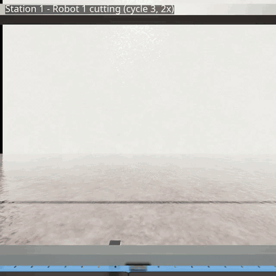
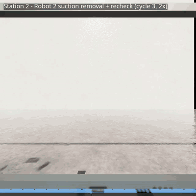

# 🙋 내 역할 — 박진용 (NetClean)

**로봇 제어 알고리즘 · Standalone 설계 · 시스템 병합 및 테스트 담당**

Isaac Sim 안에서 로봇 · 어망 · 흡착을 실제로 움직이는 실행 계층(Standalone)을 설계 · 구현하고, M0609 2대의 모션 제어와 Robot 1 절단 · Robot 2 흡착 제거 작업 순서, 실패 복구를 만들었습니다. 노드별 기능을 2 PC 분산 구조로 병합해 시험했습니다.

**다룬 기술:** Isaac Sim 5.1 Standalone(`SimulationApp` · USD · PhysX Joint · Articulation) · Lula IK · ROS 2 Jazzy(Action · Topic) · Fast DDS 2 PC 분산 · Python · pytest

**담당 코드:** `sim/standalone/netclean_standalone_v2_home_joint_fix_v2.py` · `ros2_ws/src/nc_robot/`(`robot1_node.py` · `robot2_node.py` · `transform_utils.py` · `motion_utils.py`)

---

## 1. Standalone 설계

- **판단과 실행 분리**
  - ROS 노드(Control · Robot)는 "무엇을 할지"만 정하고, Standalone은 Isaac Sim 안에서 "실제로 움직이기"(어망 이송 · 로봇 모션 · 흡착 · Joint 해제 · 리셋)만 맡습니다.
  - 실행 계층과 판단 계층의 책임을 고정해 통합 · 디버깅 범위를 줄이기 위해서입니다.
  - 두 계층은 명령 Topic과 완료 응답 Topic으로만 주고받습니다.
    - 로봇: `/robot1·2/motion_command` → `motion_done`
    - 흡착: `/robot2/suction_command` → `suction_state`
    - Joint 해제: `/robot2/release_attached_object` → `joint_release_done`
    - 어망: `/net/target_pose` → `/net/current_pose`
    - 시뮬레이션: `/sim/ready` · `/sim/reset_request` → `/sim/reset_done`
- **물리 step과 ROS를 한 루프로**
  - 물리 step과 ROS 명령 처리가 따로 돌면 명령 → 물리 → 응답의 순서가 어긋납니다.
  - → `world.step()`(60 Hz) 한 번마다 `rclpy.spin_once()`를 불러 같은 루프에서 처리합니다.
- **기능별 클래스로 분리**
  - 어망 이송 · 로봇 모션 · 흡착 · Joint 해제를 각각 클래스로 나눴습니다.
  - 루프는 매 step마다 각 클래스의 `update()`만 부릅니다.

```python
while simulation_app.is_running() and not shutting_down:
    world.step(render=RENDER_FRAMES)
    simulated_time += PHYSICS_DT
    rclpy.spin_once(ros, timeout_sec=0.0)
```

---

## 2. 로봇 제어 알고리즘

- **TCP → 플랜지 역보정 → Lula IK**
  - 로봇 노드가 보내는 목표는 공구 끝(TCP) 기준인데, IK는 플랜지 기준으로 풉니다.
  - → `T_world_flange = T_world_tcp × inverse(T_flange_tcp)`로 플랜지 목표를 계산한 뒤 Lula IK로 풉니다.
- **smoothstep 관절 보간**
  - 가장 많이 움직이는 관절 기준으로 이동 시간(최대 변화량 ÷ 0.35 rad/s)을 정합니다.
  - 매 step마다 중간 관절값을 smoothstep(0 → 1)으로 만듭니다.
  - 보간이 끝나면 IK 최종 관절값을 그대로 넣어, 흡착 TCP와 물체 사이에 남는 관절 추종 오차를 없앱니다.
- **완료는 실제 상태로 판정**
  - 명령을 보냈다고 도착한 게 아닙니다. → 관절 오차가 1° 이하일 때만 완료 응답을 보냅니다.
  - 40 s를 넘으면 현재 · 목표 관절값을 로그에 남기고 실패로 응답합니다.
- **Home은 IK 대신 관절값으로**
  - Home은 정밀 위치가 아니라 반복 시작 · 끝의 안전 자세인데, IK로 풀면 해가 매번 달라질 수 있습니다.
  - → 정해 둔 안전 관절값으로 이동합니다.
- **접촉 전 도달 범위 검사**
  - 수평 절단 자세에서는 손목 중심(TCP 뒤 0.251 m)이 어깨에서 0.779 m(상완 0.411 + 전완 0.368) 안에 있어야 닿습니다.
  - 이 여유를 접촉 전에 계산해 3 mm보다 작으면, 짝 절단점 쪽으로 절단선 길이의 35 %까지 이분 탐색으로 당깁니다.
  - 그래도 안 닿으면 IK를 시도하지 않고 바로 건너뜁니다.

```python
def _tcp_target_to_flange_target(tcp_pos, tcp_q, flange_to_tcp_pos, flange_to_tcp_q):
    """T_world_flange = T_world_tcp * inverse(T_flange_tcp)."""
    flange_q = _quaternion_multiply_wxyz(tcp_q, _quaternion_inverse_wxyz(flange_to_tcp_q))
    R = _quaternion_to_rotation_matrix_wxyz(flange_q)
    return tcp_pos - R @ flange_to_tcp_pos, flange_q

blend = _smoothstep(self._elapsed / self._duration)      # 0 → 1, 시작 · 끝에서 속도 0
command = start + blend * (target - start)

ROBOT1_REACH_MODEL = ReachModel(shoulder=(0.0, -2.0, 0.6345), arm_length=0.779,
                                wrist_from_tcp=(0.251, 0.0, 0.0056))
```

---

## 3. 절단 · 흡착 작업 순서 · 실패 복구

- **Robot 1 절단**
  - 객체마다 절단점 P1 · P2를 `APPROACH → CONTACT → HOLD → RETREAT`로 처리하고 Home으로 돌아갑니다.

<p align="center"></p>

- **Robot 2 흡착 제거**
  - `PREGRASP → CONTACT → SUCTION ON → JOINT RELEASE → RETREAT → SUCTION OFF`로 처리하고, 전체 객체가 끝나면 Home으로 돌아갑니다.
  - CONTACT는 물체 표면 12 mm 앞에서 멈춥니다. 페트병처럼 가장 튀어나온 면이 목표 표면보다 앞에 있으면 흡착컵이 먼저 닿아 곡면을 따라 미끄러지기 때문입니다.
  - 접촉 대기는 시뮬 시간 기준으로 잽니다. 시뮬 속도와 상관없이 같은 시간을 기다리게 하기 위해서입니다.

<p align="center"></p>

- **흡착 소유권 순차 전환**
  - 흡착 ON 응답을 확인한 뒤에만 어망 Joint 해제를 요청합니다.
  - Standalone은 해제 요청을 받으면 흡착 상태와 TCP–표면 거리(≤ 3 cm)를 검사하고, 통과할 때만 물체를 붙인 뒤 어망 Joint를 끕니다.
  - 물체의 물리적 소유권이 어망 → Robot 2로 순서대로 넘어갑니다.
- **흡착 계통 실패 시 복귀**
  - 접촉 자세에 멈춰 있지 않고 흡착을 끈 뒤 `RETREAT → HOME`으로 돌아옵니다.
  - ON 응답이 유실돼도 Standalone은 이미 흡착 상태일 수 있어서, OFF는 상태와 상관없이 반드시 한 번 보냅니다.
- **접촉 실패 복구**
  - 접촉에 한 번 실패했다고 공정 전체를 멈출 필요는 없습니다. → `RETREAT → RECOVERY_HOME → 재진입 → CONTACT`로 한 번 더 시도합니다.
  - 복구 Home까지 실패하면 로봇 위치를 믿을 수 없습니다. → 안전 후퇴를 한 번 더 시도하고, 그래도 안 되면 그 점만 건너뛰지 않고 Action 전체를 abort합니다.
- **좌표 규칙 통일(`transform_utils`)**
  - Robot 1 · 2가 각자 좌표를 변환하면 Quaternion 순서 · 변환행렬 규칙이 어긋납니다.
  - → Camera → World 변환 · Quaternion(xyzw) · 변환행렬 규칙을 한 모듈로 모았습니다.

```python
if not self._send_suction_and_wait(True):                 # 흡착 ON 응답까지 기다림
    self._recover_after_attachment_failure(target, retreat, 'SUCTION_ON')
    return False
if not self._release_joint_and_wait(target.class_name):   # 그 뒤에만 어망 Joint 해제 요청
    self._recover_after_attachment_failure(target, retreat, 'JOINT_RELEASE')
    return False
```

---

## 4. 시스템 병합 · 테스트

- **2 PC 분산 구조로 병합**
  - 노드별 기능을 PC A(시뮬레이션 · 제어 · 로봇)와 PC B(비전) 구조로 병합했습니다.
- **실제 상태 기준 성공 판정**
  - 단계마다 "명령을 보냈다"가 아니라 "실제로 됐다"로 성공 기준을 정했습니다.
  - 어망 도착: 실제 위치가 목표 ±2 cm 안
  - 로봇 동작: 관절 오차 1° 이하 완료 응답
  - 흡착: 흡착 상태 응답
- **단위 시험 13개 작성**
  - 도달 범위 · 시뮬 시간 대기 · RGB-D 동기화 · 이미지 변환

---

## 5. 트러블슈팅

**① 관절 명령이 한 번에 들어가 동작이 튐 → smoothstep 보간**
- **문제:** IK로 계산한 목표 관절값을 한 번에 관절 명령으로 넣으면, 현재 자세와 목표 차이가 클 때 움직임이 급격해지고 로봇이 끊기거나 물리가 떨렸습니다.
- **해결:** 매 step마다 현재와 목표 사이 중간값을 만들고, alpha를 0 → 1로 올려 목표까지 점진적으로 이동하게 했습니다.

**② 흡착보다 Joint 해제가 먼저 됨 → 흡착 소유권 순차 전환**
- **문제:** 접촉 뒤 흡착과 Joint 해제를 단순 순서 명령으로 보내면, Robot 2가 물체를 확보하기 전에 어망 연결이 먼저 풀려 물체가 떨어지거나 예측할 수 없게 움직일 수 있었습니다.
- **해결:** `SUCTION ON` 뒤 흡착 상태 응답을 기다리고, 확인된 경우에만 Joint 해제를 요청하게 했습니다.

**③ 붙는 순간 물체가 튐(Snap) → 실제 접촉 위치 기준 부착**
- **문제:** 붙이는 순간 물체가 순간이동 · 회전했고, 완벽히 닿아도 흡착 뒤 Joint 해제가 실패했습니다.
- **원인:**
  - 물체 원점이나 미리 정한 위치를 붙이는 기준점으로 써서, 실제 흡착 TCP 접촉 위치와 다르면 Joint가 생기는 순간 위치가 보정됐습니다.
  - 거리를 플랜지(link_6) 원점 기준으로 재고 있었는데, 실제 접촉면은 약 12.2 cm 떨어진 SuctionTCP라 거리가 항상 허용값을 넘었습니다.
- **해결:** SuctionTCP의 실제 월드 위치와 물체 표면(AABB) 거리를 먼저 재서 3 cm 이내일 때만 붙입니다. 그 순간의 TCP–물체 상대 위치 · 회전을 그대로 저장해 이후 TCP를 따라 움직입니다.

```python
surface_distance, *_ = _distance_to_prim_world_bounds(stage, object_body_path, tcp_pos)
if surface_distance > SUCTION_CONTACT_TOLERANCE_M:       # 3 cm
    return False                                          # 붙이지 않는다
object_pos, object_q = _get_stage_world_pose(stage, object_body_path)
self._attached_offset = object_pos - tcp_pos              # 지금 상대 위치 그대로
self._attached_rotation_offset = _quaternion_multiply_wxyz(_quaternion_inverse_wxyz(tcp_q), object_q)
```

**④ 이동 명령만 보고 도착으로 판단 → 실제 위치 확인**
- **문제:** `/net/target_pose`를 보냈다고 바로 Station 도착으로 판단하면, 어망이 아직 움직이는 중에 Vision · Robot 작업이 시작될 수 있었습니다.
- **해결:** Standalone이 발행하는 `/net/current_pose`를 계속 확인하고, 목표와의 거리가 허용오차(0.02 m) 이하일 때만 도착으로 인정합니다.

**⑤ 시뮬레이션이 멈추면 Timeout을 감지 못함 → 독립 시계 Watchdog**
- **문제:** `use_sim_time=True` 환경에서는 Isaac Sim의 `/clock`이 멈추면 ROS 시간도 같이 멈춥니다. 시뮬레이션 시간만 기준으로 Timeout을 재면 공정이 멈춰도 감지하지 못해, 상태가 무한정 대기에 머물 수 있었습니다.
- **해결:** 시뮬레이션 시간과 독립된 `STEADY_TIME` 시계로 0.25 s마다 도는 Watchdog을 두고, 상태별 Timeout(Station 1 180 s · Station 2 240 s · 리셋 45 s)을 감시합니다.

```python
self._watchdog_clock = Clock(clock_type=ClockType.STEADY_TIME)
self.create_timer(0.25, self._watchdog, clock=self._watchdog_clock)
```
