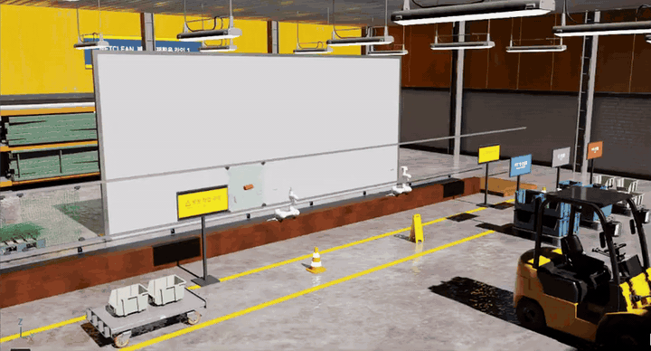
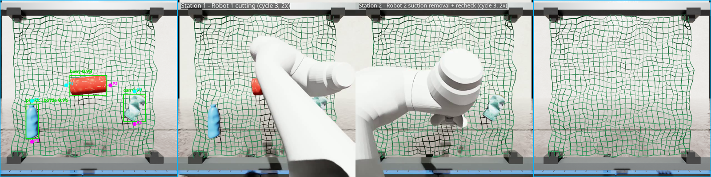
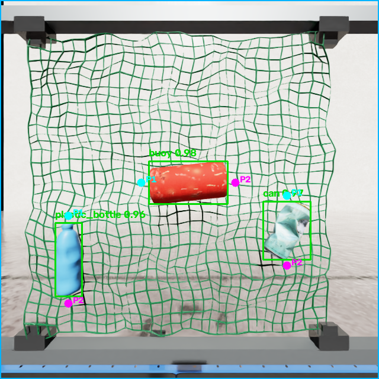
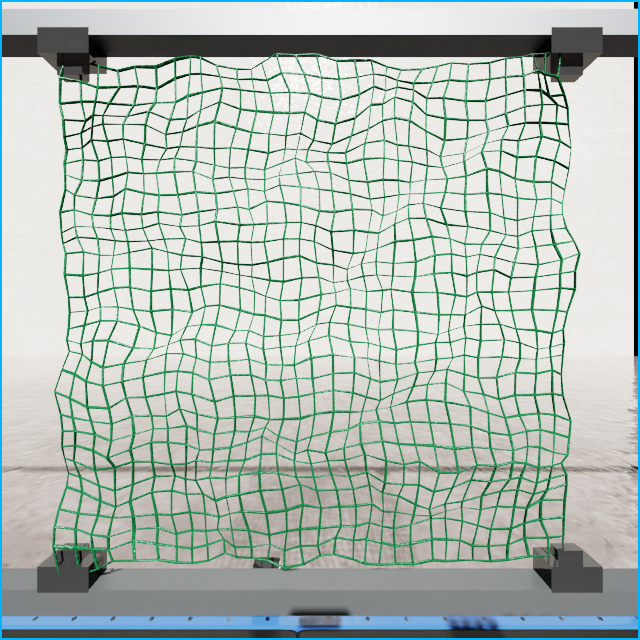
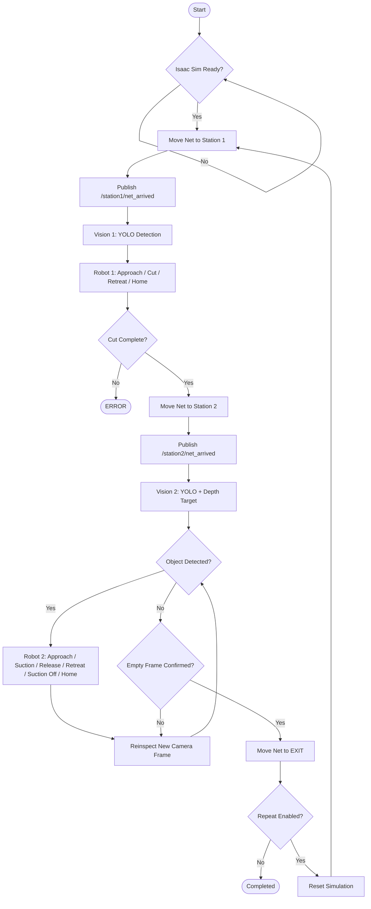
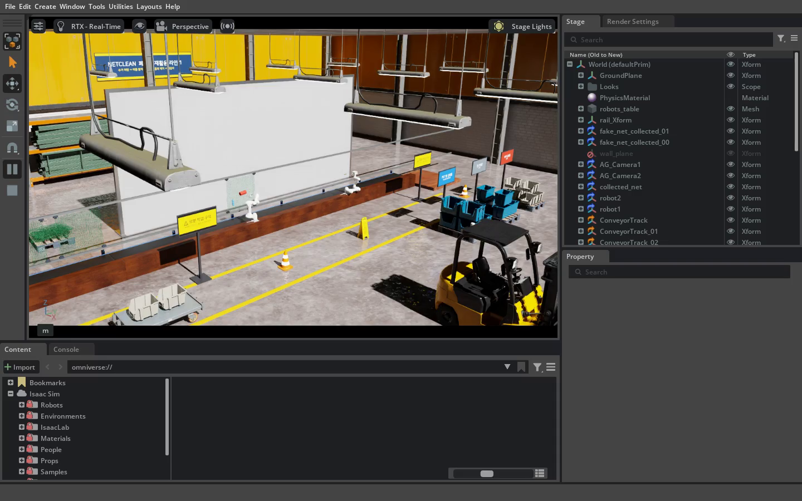

# 🕸️ NetClean — 폐어망 속 이물질을 카메라로 찾아 자르고, 흡착해 떼어낸다

<p align="center">
  
  
  
  
  
  
  
</p>

폐어망에 얽힌 플라스틱 병 · 캔 · 부표를 **카메라로 찾아 로봇 1이 어망을 자르고, 로봇 2가 흡착해 떼어낸 뒤, 다시 찍어 제거를 확인합니다.** 실제 설비를 만들기 전에 카메라 위치 · 로봇 도달성 · 물리 결합 · 공정 순서를 Isaac Sim 디지털 트윈에서 먼저 검증하는 것이 목표입니다.

> 두산 로보틱스 ROKEY Boot Camp 9기 · 협동-3 "디지털 트윈 기반 로봇 자동화 시뮬레이션 시스템 구현" · D그룹 3조 **포바오** — 이수현(팀장) · 박성현 · 박진용 · 서동권 · 멘토 손미란 (이한혁 중도 포기) · 2026.08.15 ~ 08.28

> 🙋 **박진용 — 로봇 제어 알고리즘 · Standalone 설계 · 시스템 병합 및 테스트 담당** · [내 역할 자세히 보기](MY_ROLE.md)

## 📑 목차

1. [🎬 데모](#-데모)
2. [💡 한눈에](#-한눈에)
3. [✨ 핵심 기능](#-핵심-기능)
4. [🛠️ 시스템 구조](#️-시스템-구조)
5. [🧩 트러블슈팅](#-트러블슈팅)
6. [📊 결과](#-결과)
7. [🌱 배운 점](#-배운-점)
8. [👥 팀 · 역할](#-팀--역할)
9. [🤝 개발 · 협업 방식](#-개발--협업-방식)
10. [💻 개발 환경 · 장비](#-개발-환경--장비)
11. [🚀 설치 · 실행](#-설치--실행)
12. [📁 문서](#-문서)
13. [라이선스](#라이선스)

## 🎬 데모

### ▶ 1분 시연 영상

https://github.com/user-attachments/assets/64e6e503-a420-4058-8fd8-c774d934e16e

어망이 Station 1에 도착해 절단되고, Station 2에서 흡착 제거 · 재검사를 거쳐 Exit로 나가는 전체 공정입니다.

### 🏭 공장 환경 전체 공정 — 이송 · 절단 · 제거 · 재검사

<p align="center">
  
</p>

공장 배경 월드에서 어망 이송 → 절단 → 흡착 제거 → 재검사 → Exit로 이어지는 전체 공정이 반복되는 Isaac Sim 화면입니다(8배속, 1분 47초).

### 🧭 4단계 한 장 요약

<p align="center">
  <br>
  <sub>탐지(YOLO + 절단점 P1 · P2) → Robot 1 절단 → Robot 2 흡착 제거 → 재검사(빈 어망) — 실제 실행 화면</sub>
</p>

Station별 실행 장면(GIF)은 아래 [✨ 핵심 기능](#-핵심-기능)의 Robot 1 · Robot 2 항목에 있습니다.

## 💡 한눈에

| 문제 | 우리 방법 |
|---|---|
| 폐어망 재활용 전, 어망에 얽힌 이물질 분리는 반복적이고 위험한 수작업이다 | 로봇 2대가 이물질을 찾아 **절단 → 흡착 제거 → 재검사**까지 이어서 합니다 |
| 실제 설비 없이는 카메라 위치 · 로봇 도달 범위 · 물리 결합을 미리 알기 어렵다 | Isaac Sim 디지털 트윈에서 실제 센서 · 로봇 · 물리로 공정을 먼저 돌려 봅니다 |
| 명령을 보냈다는 사실만으로는 공정이 제대로 됐는지 알 수 없다 | 어망 위치 ±2 cm · 관절 오차 ≤ 1° · 흡착 응답 같은 **실제 상태를 확인한 뒤에만** 다음 단계로 넘어갑니다 |
| 제거한 뒤 정말 비었는지 확인할 방법이 없다 | 로봇이 끝난 뒤 새 프레임으로 **재검사**해서 연속 빈 화면일 때만 Exit로 보냅니다 |

```text
[Ready] → ① Station 1 도착 → ② Vision 1 탐지(P1 · P2) → ③ Robot 1 절단 → ④ Station 2 이송 → ⑤ Vision 2 목표 → Robot 2 흡착 제거 → ⑥ 재검사(빈 화면) → Exit → 리셋 → 다음 어망
```

<details>
<summary>배경 — 왜 폐어망 이물질 분리인가</summary>

폐어망을 재활용하려면 먼저 얽힌 플라스틱 · 캔 · 부표 같은 이물질을 떼어내야 하는데, 지금은 사람이 반복해서 하고 절단 · 파지 과정에 안전 위험이 있습니다. 로봇 셀로 바꾸려면 카메라를 어디에 두고 로봇이 어디까지 닿는지부터 알아야 하는데, 이걸 실물로 시행착오하면 비용이 큽니다. 그래서 같은 구성을 **Isaac Sim 5.1 디지털 트윈**으로 먼저 만들어 비전 · 로봇 · 물리 · 공정 흐름을 검증했습니다.

</details>

## ✨ 핵심 기능

### 🔍 비전 — 어망 위 이물질의 3D 목표 생성

YOLO11n으로 `plastic_bottle` · `can` · `buoy`를 찾고, RGB · Depth를 동기화해 `Pixel(u, v) + Depth + CameraInfo K`를 카메라 좌표 → 월드 좌표로 바꿉니다. Vision 1은 객체마다 절단점 P1 · P2를, Vision 2는 흡착 목표를 만듭니다. 페트병은 투명 · 반사로 Depth가 흔들려 유효 Depth 중앙값을 씁니다.

<p align="center">
  <br>
  <sub>Vision 1 — 병 0.96 · 캔 0.97 · 부표 0.98, 객체마다 절단점 P1(청록) · P2(자홍)</sub>
</p>

### ✂️ Robot 1 — 절단

객체마다 절단점 P1 · P2를 `APPROACH → CONTACT → HOLD → RETREAT`로 처리하고 HOME으로 돌아옵니다. 접촉 전에 **M0609 도달 범위를 먼저 검사**해, 범위 밖이면 절단선을 따라 안쪽으로 당기고 그래도 닿지 않으면 시도 없이 건너뜁니다(IK 실패로 재시도하던 약 20 s를 아낍니다).

<p align="center">
  <br>
  <sub>Station 1 — Robot 1 절단</sub>
</p>

### 🧲 Robot 2 — 흡착 제거

`PREGRASP → CONTACT → SUCTION ON → JOINT RELEASE → RETREAT → SUCTION OFF → HOME`. **흡착 성공 응답을 확인한 뒤에만** 어망과 물체를 잇는 Fixed Joint를 해제합니다. CONTACT는 물체 표면에서 12 mm 앞에서 멈춰, 튀어나온 부분에 흡착컵이 먼저 닿아 미끄러지는 문제를 피합니다.

<p align="center">
  <br>
  <sub>Station 2 — Robot 2 흡착 제거 · 재검사</sub>
</p>

### 🔁 재검사와 Closed-loop 공정

제거 뒤에는 로봇이 끝난 **이후에 찍힌 새 프레임**으로 다시 탐지하고, 빈 프레임이 연속으로 확인되면 Station 2를 끝냅니다.

<p align="center">
  <br>
  <sub>Vision 2 재검사 — 제거 후 빈 어망</sub>
</p>

### ⏱️ 상태로 넘어가는 공정

Net 도착은 `/net/current_pose`가 목표 ±2 cm 안에 들어왔을 때만 인정하고, 로봇 모션은 관절 오차 ≤ 1° 와 완료 응답으로 판정합니다. Vision은 도착 후 **어망이 멈춘 프레임**(도착 시각 + 1 s 이후)만 사용합니다.

### 🛡️ 예외 처리

| 상황 | 동작 |
|---|---|
| Robot 1 접촉 실패 | `RETREAT → RECOVERY_HOME → APPROACH → CONTACT`로 한 번 더 시도, 두 번 실패하면 **그 절단점만 건너뛰고** 다음으로 진행 |
| Robot 1 도달 범위 밖 | 절단선 안쪽으로 당겨 보고, 안 되면 시도 없이 건너뜀 |
| Robot 1 · 2 복구 실패 | `RECOVERY_HOME`과 안전 재후퇴까지 실패하면 로봇 위치를 믿을 수 없으므로 **전체 Action abort** |
| Robot 2 접촉 실패 | `RETREAT → RECOVERY_HOME → PREGRASP → CONTACT`로 한 번 더 시도, 그래도 실패하면 Action 실패 종료 |
| Robot 2 흡착 · Joint 해제 실패 | 재시도 없이 (흡착 실패 시 **Joint Release를 요청하지 않고**) 흡착을 끄고 `RETREAT → HOME`으로 안전 복귀한 뒤 Action 실패 종료 |
| Net 이동 중 | 보냈다는 사실이 아니라 실제 위치가 허용오차(`position_tolerance` 0.02 m) 안일 때만 도착 처리 |
| Vision 신호 유실 | 도착 신호를 대기 중 1 s마다 재발행하고 완료 · 오류 · 리셋 때 False로 해제 |
| 시뮬 리셋 | 카메라 시각이 0으로 되감기면 RGB-D 동기화 큐를 비움 |
| 상태가 멈춤 | wall clock(STEADY_TIME) 기반 0.25 s Watchdog이 상태별 timeout 감시(Station 1 · 180 s, Station 2 · 240 s, 리셋 · 45 s). `/clock`이 멈춰도 동작 |
| 탐지 대기 | Vision 1은 `plastic_bottle` · `can` · `buoy` **3종이 모두 보일 때** 절단을 시작 |

## 🛠️ 시스템 구조

### 아키텍처

시스템은 `Simulation` · `Decision & Control` · `Perception` 세 계층이고, 두 PC가 DDS(Fast DDS)로 연결됩니다. 시뮬레이션 실행 계층과 판단 계층을 나눠 책임을 고정하고 통합 · 디버깅 범위를 줄였습니다.

<p align="center">
  <br>
  <sub>PC A(Isaac Sim 실행 · 공정 제어 · Robot 노드)와 PC B(Vision · YOLO11 추론)를 ROS 2 DDS 로 연결</sub>
</p>

| 위치 | 구성 | 역할 |
|---|---|---|
| Simulation PC | Isaac Sim 5.1 + `netclean_standalone_v2_home_joint_fix_v2.py` | USD 월드 · 물리 · 카메라 · 어망 이송 · Lula IK 모션 · 흡착 · Joint 해제 실행 |
| PC A | `nc_control` · `nc_robot`(Robot 1 · 2) | 공정 순서 · 작업 순서 · 실패 복구 |
| PC B | `nc_vision`(Vision 1 · 2) · YOLO11 | 탐지 · 3D 목표 생성 · 재검사 |

<p align="center">
  <br>
  <sub>노드 구조 — control_node가 공정을 관리하고, vision · robot 노드가 작업 결과와 요청을 주고받으며, standalone이 실제 물리 동작을 수행합니다</sub>
</p>

| 패키지 | 역할 |
|---|---|
| `nc_interfaces` | `ExecuteCut` · `ExecuteRemove` Action, `CutTarget` · `RemoveTarget` 메시지 |
| `nc_control` | 어망 이송과 전체 공정 상태 머신 |
| `nc_robot` | Robot 1 절단 · Robot 2 흡착 · 수거 Action Server, 공용 좌표 변환(`transform_utils`) |
| `nc_vision` | YOLO11 추론, RGB-D 좌표 계산, Action Client |
| `nc_vision_debug` | Vision 1 · 2 디버그 팝업과 대시보드 영상 |
| `nc_bringup` | PC A · PC B 실행 파일과 공통 파라미터 |

### 주요 통신

| 방식 | 인터페이스 | 송신 → 수신 | 역할 |
|---|---|---|---|
| Topic | `/sim/ready` | Standalone → Control | 시뮬레이션 준비 |
| Topic | `/net/target_pose` · `/net/current_pose` | Control ↔ Standalone | Net 목표 위치 · 실제 위치 피드백 |
| Topic | `/station1/net_arrived` · `/station2/net_arrived` | Control → Vision | Station 도착 알림 |
| Action | `/cut/execute` | Vision 1 → Robot 1 | 절단 목표 작업 요청 |
| Action | `/remove/execute` | Vision 2 → Robot 2 | 제거 목표 작업 요청 |
| Topic | `/robot1/motion_command` · `/robot2/motion_command` | Robot → Standalone | TCP Pose 전달 |
| Topic | `/robot1/motion_done` · `/robot2/motion_done` | Standalone → Robot | 실제 모션 완료 응답 |
| Topic | `/robot2/suction_command` · `/robot2/suction_state` | Robot 2 ↔ Standalone | 흡착 ON/OFF · 상태 응답 |
| Topic | `/robot2/release_attached_object` · `/robot2/joint_release_done` | Robot 2 ↔ Standalone | Net Joint 해제 요청 · 결과 |
| Topic | `/station1/cut_complete` | Robot 1 → Control | Station 1 절단 작업 완료 |
| Topic | `/station2/complete` | Vision 2 → Control | Station 2 제거 · 재검사 완료 |
| Topic | `/process/state` · `/process/fault` | Control → 전체 | 공정 상태 · 오류 |
| Topic | `/sim/reset_request` · `/sim/reset_done` | Control ↔ Standalone | 다음 어망을 위한 시뮬레이션 리셋 요청 · 완료 |

### 동작 흐름

<p align="center">
  <br>
  <sub>전체 공정 플로우 차트</sub>
</p>

```
① 이송    어망이 Station 1에 도착합니다 (실제 위치가 목표 ±2 cm 안에 들어올 때까지 확인)
② 탐지    Vision 1이 이물질(plastic_bottle · can · buoy)을 찾고 객체별 절단점 P1 · P2를 만듭니다
③ 절단    Robot 1이 Approach → Contact → Hold → Retreat를 P1 · P2에 대해 수행하고 HOME으로 돌아갑니다
④ 이송    어망이 Station 2로 이동합니다
⑤ 제거    Vision 2가 목표를 만들면 Robot 2가 접근 → 흡착(응답 확인) → Joint 해제 → 이탈 → 흡착 해제 → HOME
⑥ 재검사  로봇 완료 이후의 새 프레임으로 다시 찍어 이물질이 없으면(연속 빈 프레임) Exit로 이송합니다
```

<details>
<summary>텍스트(Mermaid)로 보는 흐름도</summary>



</details>

공정 상태는 `WAIT_SIM → MOVING_STATION1 → WAIT_STATION1_COMPLETE → MOVING_STATION2 → WAIT_STATION2_COMPLETE → MOVING_EXIT → COMPLETED`(반복 시 `RESETTING`)입니다. 상태가 맞지 않을 때 들어온 완료 메시지는 무시하므로, 메시지 순서가 뒤바뀌어도 공정 순서는 바뀌지 않습니다.

## 🧩 트러블슈팅

Isaac Sim + ROS 2로 전체 공정을 실행하며 막힌 곳 7가지를 원인부터 좁혀 하나씩 고쳤습니다. 대표 4건이고 나머지 3건은 접어 두었습니다. 상세 분석은 [`docs/TROUBLESHOOTING.md`](docs/TROUBLESHOOTING.md)에 있습니다.

| 문제 | 원인 | 어떻게 해결했나 | 결과 |
|---|---|---|---|
| 리셋 뒤 Vision 1이 116 ~ 137 s 동안 무응답 | 리셋으로 시뮬 시간이 0으로 되감기는데 RGB-D 동기화 큐에 리셋 전 프레임이 남아, 새 프레임을 "가장 오래된 것"으로 버림 | 도착 시 · 타임스탬프가 되감길 때 큐를 비우는 `sync_utils.py` 추가(실제 동기화기를 재현하는 단위 시험 포함) | **전체 공정 연속 완주** |
| Robot 2 흡착이 가끔 거부(표면 거리 3.3 ~ 4.7 cm > 허용 3 cm) | Vision 2가 어망이 멈추기 전 프레임을 써서 목표가 0 ~ 5 cm 밀림 | `arrival_settle_sec`: 도착 후 첫 프레임 시각 + 1 s 이후의 프레임만 사용(카메라 시각 기준) | 페트병 검출 위치 **매번 동일**(129 px), 흡착 거부 **0**, 제거 **18/18** |
| 페트병 흡착 여유가 3 mm뿐(표면 거리 2.70 cm / 허용 3 cm) | 흡착컵이 튀어나온 면에 먼저 닿아 TCP가 옆으로 4 ~ 7 cm 미끄러짐 | CONTACT를 표면 12 mm 앞에서 정지, 대기를 시뮬 시간 기준으로 | 흡착 거리 **0.37 ~ 0.61 cm**, 공장 배경 월드도 완주 |
| Robot 1이 일부 절단점에서 IK 실패 → 재시도 후 skip | 어망 가장자리의 위쪽 절단점이 M0609 도달 범위를 6.5 ~ 11.4 mm 넘음(FK로 재현) | 접촉 전 도달 검사, 범위 밖이면 절단선을 따라 안쪽으로 당기고 안 되면 바로 skip | IK 실패 **0**, 절단점 **36/36** |

<details>
<summary>나머지 3건 보기 — 헤드리스 · OpenCV 5 · 도착 신호</summary>

| 문제 | 원인 | 어떻게 해결했나 | 결과 |
|---|---|---|---|
| `--headless`에서 카메라 토픽이 없음 | standalone이 `world.step(render=not headless)`로 렌더링을 건너뜀 | 헤드리스에서도 렌더링(`RENDER_FRAMES`), 물리만 돌릴 때는 `--no-render` | 헤드리스 실행 완주 |
| Vision 1이 매 프레임 `KeyError: 16`, Station 1 timeout | pip OpenCV 5와 Jazzy `cv_bridge`(OpenCV 4.6 빌드)의 `cv2_to_imgmsg` 충돌 | `image_msg_utils.py`로 디버그 이미지를 직접 변환 | Station 1 통과 |
| 두 번째 어망부터 Vision 1이 도착 신호를 무시 | Control이 `/stationN/net_arrived`를 False로 되돌리지 않아 Vision이 재무장되지 않음 | 완료 · 오류 시 False 발행, 대기 중 1 s마다 True 재발행 | 반복 공정 정상 |

</details>

## 📊 결과

<p align="center">
  
  
  
  
  
</p>

| 지표 | 결과 |
|---|---|
| 전체 흐름 | **전체 공정 연속 완주** — 원본 월드와 공장 배경 월드 모두 |
| 절단 | 절단점 **36/36** · IK 실패 0 (도달 범위 안쪽으로 당긴 점 7개) |
| 흡착 제거 | 병 · 캔 · 부표 **18/18** · 흡착 거부 0 · 페트병 흡착 표면 거리 0.37 ~ 0.61 cm (허용 3 cm) |
| Vision 2 위치 정확도 | 물체 중심 대비 가로 · 세로 **1.4 cm 이내**(흡착 허용 3 cm) |
| 물체 탐지 | YOLO11n · 100 epoch · P 0.9994 · R 1.0 · mAP50 0.995 · mAP50-95 0.994 (합성 데이터 검증셋) · 추론 6.1 ms/프레임 |
| 공정 1회 소요 시간 | 원본 월드 121 ~ 148 s · 공장 배경 월드 135 ~ 143 s |
| 시스템 | 카메라 2대 RGB-D 약 46 Hz · 빌드 패키지 6개 · 단위 시험 **18 passed** |

<details>
<summary>공장 배경 월드</summary>

공장 배경 월드(`simulation_integration_v4_factory.usda`)는 원본 v4 월드 위에 장식 레이어 3개를 얹었습니다. 장식은 모두 시각 전용이고(충돌 · 강체 · 조인트 끔), 카메라에 들어오는 것은 어망 뒤 차폐판 1장뿐입니다. 같은 장면 렌더 비교에서 YOLO 신뢰도 차이 ±0.001, 박스 중심 이동 ≤ 0.2 px, Vision 2 3D 목표 차이는 최대 1.5 mm였습니다. 자세한 내용은 [`sim/assets/factory/README.md`](sim/assets/factory/README.md)에 있습니다.

<p align="center">
  <br>
  <sub>공장 배경 월드(Isaac Sim 화면)</sub>
</p>

</details>

## 🌱 배운 점

- 시뮬레이션에는 시계가 셋(`/clock`, 카메라 프레임 시각, 벽시계)이고, 리셋하면 서로 어긋납니다. 대기 · 동기화 · 판정이 어느 시계를 쓰는지 정해 두지 않으면 증상이 실행마다 달라져 원인을 찾기 어려웠습니다.
- "IK가 가끔 실패한다"는 증상을 FK로 재현해 보니 솔버 문제가 아니라 기구학적으로 도달할 수 없는 점이었습니다. 로그와 재현 코드로 원인을 확정한 뒤 고치는 편이 빨랐습니다.
- 라이브러리 충돌(OpenCV 5와 `cv_bridge`)과 시간 문제는 실제 센서 · 물리가 도는 시뮬레이션을 끝까지 실행해 봐야 드러났습니다. 실행 환경까지 포함한 통합 시험을 일정 안에 넣어야 합니다.

## 👥 팀 · 역할

| 이름 | 맡은 것 |
|---|---|
| 이수현(팀장) | 비전 알고리즘 설계 · Replicator 데이터 생성 · YOLO11 모델 구축 · 2D → 3D 좌표 변환 · Vision 노드와 Robot Action 연동(비전 통합) · 제출 구성 · 문서 정리 · 테스트 |
| 박성현 | 인터페이스 설계 · 로봇 제어 알고리즘 · 시스템 통합 구조 개선(책임 · 인터페이스 재설계) · 최종 통합 검증 |
| 박진용 | 로봇 제어 알고리즘 설계 · standalone 설계(좌표 · 물리 · Joint · TCP 설정) · 로봇 통합(Robot · Control · Standalone 연동) · 테스트 |
| 서동권 | USD · 에셋 제작 · Isaac Sim 디지털 트윈 환경 구축(Net · Robot · Camera 구성) · ROS 2 통신 연동 · 시뮬레이션 안정화 |

## 🤝 개발 · 협업 방식

2주(8/15 ~ 8/28) 동안 **ROS 2 패키지 6개 · 단위 시험 18개 · 트러블슈팅 7건**. 4명이 USD 월드 · 비전 · 로봇 제어 · Standalone을 나눠 브랜치(`feat/dg` · `feat/jy` · `feature/su` · `feature/su2`)에서 개발하고, 인터페이스(Topic · Action 이름)를 먼저 정해 노드별로 나눠 개발했습니다.

<details>
<summary>일정 · 통합 흐름</summary>

| 기간 | 단계 | 활동 · 비고 |
|---|---|---|
| 8/15 ~ 8/17 | 사전 기획 | 프로젝트 기획 · 주제 선정, 기존 기술 · 에셋 자료조사, Business Requirements 작성 · 아이디어 선정, 도전 지점 논의 |
| 8/16 ~ 8/18 | 환경 검증 · 기술 통합 | System requirements 정의 · 설계, 에셋과 알고리즘 수집, 환경 상세 설계 · 사용할 에셋 제작, 비전 모델 선택 |
| 8/20 ~ 8/25 | 단위 개발 · 테스트 | 인터페이스 설계, 구체적 설계 및 기능 추가 · 모델 학습, 로봇 제어, Isaac Sim 환경 구축 |
| 8/22 ~ 8/27 | 통합 시스템 구축 · 테스트 | 전체 시스템 통합 및 자동화 · PC 간 통신, 설계 호환 확인 |
| 8/24 · 8/27 · 8/28 | 시연 · 발표 | 1차 개발, 프로젝트 시연, 팀별 최종 프로젝트 발표(이틀간 최종 시연과 발표) |

- **협업 도구:** Git/GitHub · Slack · Notion(일일 노트) · Google Drive
- **문서:** 설치 · 실행 안내 [`README_INSTALL.md`](README_INSTALL.md), 트러블슈팅 [`docs/TROUBLESHOOTING.md`](docs/TROUBLESHOOTING.md)

</details>

## 💻 개발 환경 · 장비

<details>
<summary>OS · 미들웨어 · 시뮬레이터 · 라이브러리 · 장비 표</summary>

| 항목 | 값 |
|---|---|
| OS · 미들웨어 | Ubuntu 24.04 · ROS 2 Jazzy · Fast DDS(`rmw_fastrtps_cpp`) |
| 시뮬레이터 | NVIDIA Isaac Sim 5.1.0 (USD · Articulation · Lula IK · ROS 2 Bridge) |
| 언어 · 라이브러리 | Python 3 · `rclpy` · `cv_bridge` · `message_filters` · OpenCV · NumPy · Ultralytics YOLO11 |
| 협업 | Git/GitHub · Slack · Notion · Google Drive |

| 구성 요소 | 모델 · 형식 | 역할 · ROS 연결 |
|---|---|---|
| Robot 1 | Doosan M0609 + 인두기형 커터(Isaac Sim에서 자체 제작, `CutterTCP`) | Station 1 폐어망 절단 |
| Robot 2 | Doosan M0609 + OnRobot VG10 흡착 그리퍼(`SuctionTCP`) | Station 2 폐기물 흡착 · 수거 |
| Camera 1 · 2 | Intel RealSense D455(시뮬레이션) · 640×640 | `/camera1/*` · `/camera2/*` RGB · Depth · CameraInfo |
| Transport | Net rigid body + Carriage 4개 | `/net/target_pose` · `/net/current_pose` |

</details>

## 🚀 설치 · 실행

Ubuntu 24.04 + ROS 2 Jazzy PC에서 **빌드 · 단위 시험**까지 해 볼 수 있습니다. 전체 시스템은 Isaac Sim 5.1이 설치된 NVIDIA GPU PC 1대에서 터미널 3개로 실행합니다.

<details>
<summary>빠른 시작 — 받기 · 빌드 · 시험</summary>

```bash
git clone https://github.com/suuuhululu/isaac_ros2_waste_net_cutting2.git
cd isaac_ros2_waste_net_cutting2
pip install -r requirements.txt         # ultralytics · numpy<2(ROS cv_bridge 호환) · opencv-python · pytest
cd ros2_ws && source /opt/ros/jazzy/setup.bash && colcon build && source install/setup.bash && cd ..
python3 -m pytest ros2_ws/src/nc_vision/test/test_vision_geometry.py ros2_ws/src/nc_vision/test/test_sync_utils.py ros2_ws/src/nc_vision/test/test_image_msg_utils.py ros2_ws/src/nc_robot/test/test_motion_utils.py -q     # 18 passed
```

</details>

<details>
<summary>전체 실행 — Isaac Sim + PC A · PC B (같은 PC)</summary>

모든 터미널에서 `source /opt/ros/jazzy/setup.bash && source ros2_ws/install/setup.bash`, `export ROS_DOMAIN_ID=144 RMW_IMPLEMENTATION=rmw_fastrtps_cpp`를 먼저 합니다.

| 순서 | 대상 | 명령 |
|---|---|---|
| ① | PC A (control · robot1 · robot2) | `ros2 launch nc_bringup pc_a.launch.py` |
| ② | PC B (vision1 · vision2) | `ros2 launch nc_bringup pc_b_v2.launch.py` |
| ③ | Isaac Sim | `export ISAAC_SIM_ROOT=<설치경로>` → `./scripts/run_standalone.sh` (GUI 없이: `--headless`) |

- 시뮬레이터가 `/sim/ready`를 보내면 Control이 공정을 시작하고, 어망 → 절단 → 제거 → 재검사 → Exit → 리셋을 반복합니다.
- 기본 월드는 `sim/assets/project1/simulation_integration_v4_factory.usda`(공장 배경)입니다. 원본 월드로 돌리려면 `NETCLEAN_USD=$PWD/sim/assets/project1/simulation_integration_v4.usd ./scripts/run_standalone.sh`.
- `device: "0"`은 `nc_bringup/config/vision*_v2.yaml`에서 GPU 번호입니다. 자세한 안내는 [`README_INSTALL.md`](README_INSTALL.md)에 있습니다.

</details>

## 📁 문서

| 문서 | 내용 |
|---|---|
| [`docs/`](docs/README.md) | 문서 지도 — 처음 읽는 순서 · 문서별 안내 |
| [`ros2_ws/src/`](ros2_ws/src/README.md) | ROS 2 패키지 6개 — 패키지별 역할 · 노드 · 실행 파일 · 시험 |
| [`README_INSTALL.md`](README_INSTALL.md) | 설치 · 빌드 · 시험 · 전체 실행 순서 · 월드 선택 · 연동 확인 · 문제 해결 |
| [`docs/TROUBLESHOOTING.md`](docs/TROUBLESHOOTING.md) | 트러블슈팅 7가지 — 증상 · 원인 · 해결 · 결과와 상세 설명 |
| [`sim/assets/factory/README.md`](sim/assets/factory/README.md) | 공장 배경 에셋 레이어 구성 |
| [`docs/ASSET_MANAGEMENT.md`](docs/ASSET_MANAGEMENT.md) | 최종 월드(v4 · 공장 배경) 구성 · 에셋 포함 범위 · Git 관리 정책 |
| [`models/netclean_yolo11n/README.md`](models/netclean_yolo11n/README.md) | YOLO11n 탐지 모델 — 학습 설정 · 성능 · 사용 방법 |
| [`THIRD_PARTY_NOTICES.md`](THIRD_PARTY_NOTICES.md) | 외부 에셋 출처 · 라이선스 |

<details>
<summary>폴더 구조</summary>

```text
isaac_ros2_waste_net_cutting2/
├── models/netclean_yolo11n/      YOLO 설정과 best.pt
├── ros2_ws/src/                  ROS 2 패키지 6개
│   ├── nc_interfaces/            ExecuteCut · ExecuteRemove Action, CutTarget · RemoveTarget 메시지
│   ├── nc_control/               어망 이송과 전체 공정 상태 머신
│   ├── nc_robot/                 Robot 1 절단 · Robot 2 흡착 Action Server, 좌표 변환 · 모션 유틸
│   ├── nc_vision/                YOLO11 추론 · RGB-D 좌표 계산 · 동기화 · Action Client
│   ├── nc_vision_debug/          Vision 1 · 2 디버그 팝업과 대시보드 영상
│   └── nc_bringup/               PC A · PC B 실행 파일과 공통 파라미터
├── scripts/                      run_standalone.sh · verify_submission.py · make_submission_archive.sh
├── sim/
│   ├── assets/project1/          메인 USD(v4 · v4_factory) · M0609 URDF · 참조 에셋
│   ├── assets/factory/           공장 배경 레이어 · 소품 · 텍스처
│   ├── cobot3_ws/                Robot 1 상대 참조 USD
│   └── standalone/               netclean_standalone_v2_home_joint_fix_v2.py (실행 최종본)
├── docs/                         문서 지도(README.md) · 트러블슈팅 · 에셋 관리 · README 이미지
├── README_INSTALL.md
├── requirements.txt              pip 의존성
└── LICENSE · LICENSES/ · THIRD_PARTY_NOTICES.md
```

</details>

## 라이선스

[Apache License 2.0](LICENSE). 외부 에셋의 출처와 라이선스는 [THIRD_PARTY_NOTICES.md](THIRD_PARTY_NOTICES.md)를 따릅니다.
